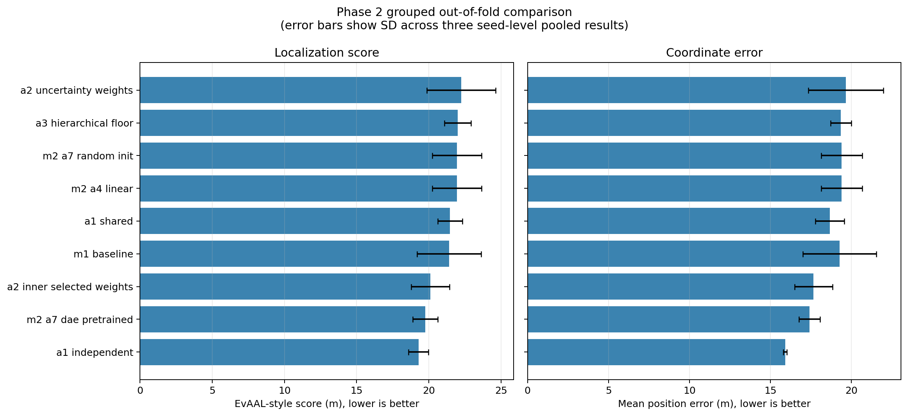
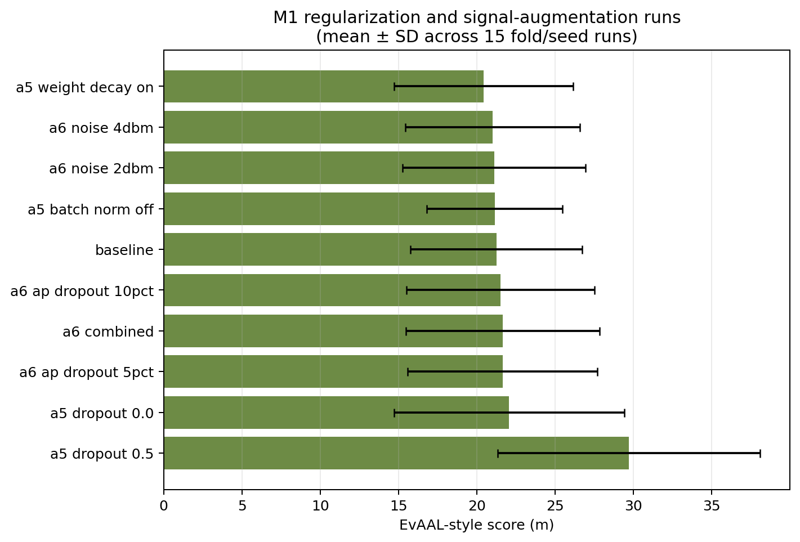
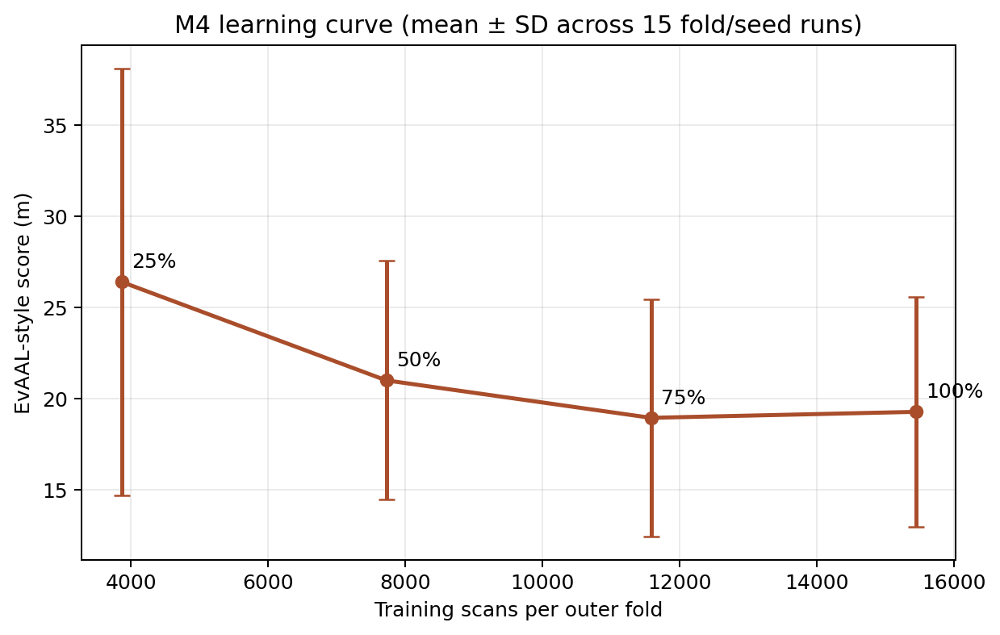
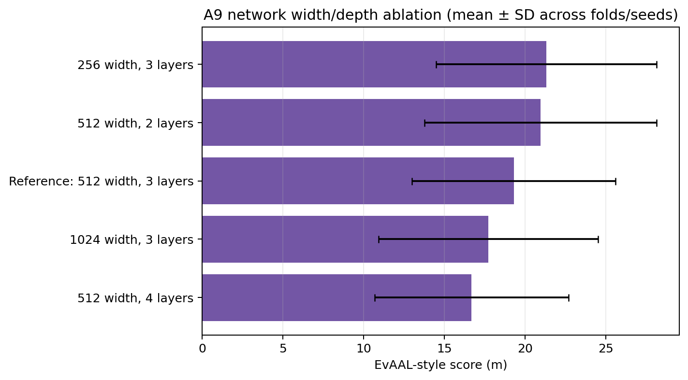

# Indoor Wi-Fi Localization — Phase 2 Integrated Report

## Abstract

This phase evaluates deep-learning and hybrid methods for predicting building, floor, and indoor coordinates from UJIIndoorLoc Wi-Fi signal fingerprints. Experiments use cleaned training data, user-grouped cross-validation, three random seeds, fold-specific preprocessing, and out-of-fold predictions. Available results show that independent task networks achieve the lowest observed localization score among the completed arms, while paired user-level uncertainty does not establish a reliable EvAAL improvement over the shared MLP or M1 baseline. Denoising pretraining improves localization metrics over random initialization in M2's available A7 comparison, with lower floor accuracy. M5's controlled A9 sweep favors a deeper 512-wide model descriptively. M2's A8 hybrid remains incomplete.

## 1. Objective and scope

The objective is to compare model designs for offline Wi-Fi fingerprint localization. For each scan, the system predicts a building class, a floor class, and longitude/latitude coordinates in metres. The project uses recorded CSV scans; it does not perform live Wi-Fi scanning, query a live database, or deploy a mobile application.

The data comes from the UJIIndoorLoc dataset published through the UCI Machine Learning Repository (DOI: [10.24432/C5MS59](https://doi.org/10.24432/C5MS59)). The source training file contains 19,937 rows. Removing 637 exact duplicate training rows leaves 19,300 cleaned scans. Phase 1 drops 55 training-constant WAP columns; Phase 2 restores their positions as missing signals to preserve a fixed 520-WAP input layout. The official 1,111-row validation file is not used in the Phase 2 experiments; it was evaluated earlier for a fixed-setting Phase 1 baseline and is not an untouched test set for new model selection.

## 2. Shared evaluation protocol

- Five outer `GroupKFold` partitions keep every `USERID` entirely in one partition. Each scan is evaluated out of fold once per model and seed.
- Runs use random seeds 42, 1337, and 2024.
- Signal absence is represented by the UJIIndoorLoc `+100` sentinel and mapped to zero in linear-positive RSSI views. Coordinate scaling is fit on training users only and predictions are inverse-transformed before metre-based scoring.
- Architecture, stopping epoch, and loss weights are selected only from outer-training users where the member's protocol calls for selection. The outer held-out users are used for final scoring.
- The primary combined metric is the EvAAL-style score: `position error + 50 m × wrong-building indicator + 4 m × wrong-floor indicator`. Classification accuracy and mean coordinate error are reported alongside it.
- All summaries distinguish pooled scan-level OOF metrics from across-run variation. M4's paired intervals resample USERID clusters; its scan-level McNemar p-values are exploratory because scans within one user are dependent.

**Architecture comparability caveat:** M1's A5/A6 runs and M2's A4/A7 reference use the temporary `520 → 256 → 128` interface architecture. M3 uses its final `520 → 512 → 256 → 128` trunk and nonlinear coordinate head. A5/A6 and A4/A7 contrasts are controlled within their own experiment families, but cross-member rows in the comparison table are descriptive comparisons of complete pipelines, not architecture-matched causal comparisons. M1's inner-split limitation also affects early-stopping selection on outer folds 0 and 1. Rerun M1 on M3's final factory with label-covered inner folds before making claims that its regularization/augmentation findings transfer to that architecture.

## 3. Work completed by member

| Member | Work and output | Status and interpretation |
|---|---|---|
| M1 | Data pipeline, robustness and regularization experiments A5/A6; five folds × three seeds; run-level predictions and summaries. | Initial sweep uses the temporary 520→256→128 stub and plain inner GroupKFold; results are provisional for transfer to M3's final model. |
| M2 | A4 RSSI representation comparisons and A7 denoising-pretraining comparison; row-aligned OOF predictions. | A4/A7 are controlled within M2's 520→256→128 reference architecture. A8's current runner is stub-backed and lacks required candidates, so its outputs are not valid results and are excluded. |
| M3 | Shared and independent multitask networks, fixed and learned loss weighting, hierarchical floor prediction; five configurations × five folds × three seeds. | Complete. The model and run artifacts are under `src/models/dl/` and `results/phase2/m3/`. |
| M4 | Paired OOF comparisons, USERID-cluster bootstrap intervals, floor calibration, per-user results, worst-error queue, and training-size learning curve. | Completed for valid available arms. A8 is excluded; final candidate selection and interpretation remain. |
| M5 | Cross-member integration, report tables/figures, and A9 width/depth controlled sweep. | Complete for available work. A8 remains pending with M2; update this report after valid A8 results exist. |

## 4. Main cross-member comparison

The table pools scans across the three seed-level OOF runs. M2 arms are limited to valid A4/A7 results. These means are descriptive and should be read with the paired USERID bootstrap intervals in the M4 report.

| Model | EvAAL-style score (m) | Mean position error (m) | Floor accuracy | Building accuracy |
|---|---:|---:|---:|---:|
| M3 independent task networks | **19.29** | **15.91** | 82.18% | 94.66% |
| M2 A7 DAE-pretrained | 19.76 | 17.42 | 82.13% | 96.70% |
| M3 inner-selected fixed loss weights | 20.11 | 17.66 | 81.23% | 96.61% |
| M1 fixed baseline | 21.41 | 19.28 | 81.90% | 97.18% |
| M3 shared multitask | 21.47 | 18.67 | 81.86% | 95.85% |
| M2 A4 linear-positive neural reference | 21.95 | 19.40 | 82.50% | 96.30% |
| M2 A7 random initialization | 21.95 | 19.40 | 82.50% | 96.30% |
| M3 hierarchical floor head | 22.00 | 19.36 | 81.42% | 96.20% |
| M3 learned uncertainty weights | 22.25 | 19.66 | 81.03% | 96.34% |

M3's independent-task model is the best observed completed arm on EvAAL and coordinate error. Its paired USERID-bootstrap EvAAL difference is −1.11 m versus the shared M3 control (95% CI −2.76 to 0.38) and −1.62 m versus the M1 baseline (−3.77 to 0.41); both intervals include zero. It is therefore appropriate to call it the best observed score, but not a proven statistically reliable EvAAL improvement. Its position-error advantage over M1 is −2.80 m (95% CI −4.36 to −1.53).

For A7, DAE-pretraining versus random initialization has a paired user-mean EvAAL difference of −1.32 m (95% CI −2.48 to −0.39). Floor accuracy is 1.1 percentage points lower (−2.0 to −0.3 points). These are exploratory unadjusted comparisons across several models.



## 5. Member-level findings

### M1: robustness and regularization

Across M1's 15 fold/seed runs per configuration, weight decay (`1e-4`) has the lowest mean EvAAL score in the M1 table at 20.43 ± 5.71 m. The baseline is 21.24 ± 5.49 m; strong dropout at 0.5 is worse at 29.70 ± 8.39 m. The noise and access-point dropout augmentations are near the baseline range. The inner-split caveat in the M1 report applies to these A5/A6 stopping choices.



### M2: representations and pretraining

The valid A4/A7 OOF predictions are included in the cross-member comparison. The A7 pretrained and random-initialized arms are protocol-identical apart from trunk initialization. Their row-aligned comparison supports lower localization errors with DAE pretraining in the current runs, alongside a modest floor-accuracy tradeoff. A8 is excluded until it uses the real M3 representation and completes the named hybrid candidates under the grouped protocol.

### M3: multitask ablations

M3 compares a shared trunk with independent task trunks (A1), inner-selected and learned uncertainty loss weights (A2), and a building-probability-conditioned floor head (A3). The independent task networks give the lowest observed EvAAL score. Inner-selected fixed weights improve over the shared control descriptively; learned uncertainty weighting and the hierarchical floor head do not improve the headline localization score in the current sweep. M4's paired uncertainty does not establish a significant EvAAL gain for independent over shared.

### M4: statistical and error analysis

M4 resampled 18 USERID clusters for paired 95% intervals, produced per-user metrics, examined 100 worst coordinate errors per seed for the independent M3 model, and inferred floor probabilities from held-out M3 checkpoints. M3 floor ECE is about 0.139–0.146 across arms using 15 equal-width bins. The independent model's NLL (1.503) is higher than the shared model's (1.261), so its best floor accuracy does not mean its probabilities are better calibrated.



The learning curve retrains the independent M3 architecture at 25%, 50%, 75%, and 100% of outer-training scans with the same held-out users. Epoch counts are frozen from each matching M3 inner-validation run, so this is a data-volume curve under a fixed training schedule. Localization errors generally decline from 25% to 100%, with high fold/seed variability and a small non-monotonic difference between 75% and 100%.

## 6. M5 A9: width and depth

M5 varied one architecture factor at a time around the existing 512×3 independent-task model. Every variant was evaluated on the same five USERID folds and three seeds; the 512×3 reference reuses M3's existing runs. Each value below is the mean ± sample standard deviation over the 15 fold/seed run metrics (unlike the pooled scan table in Section 4).

| Width × depth | EvAAL (m), mean ± SD | Position error (m), mean ± SD | Floor accuracy | Building accuracy |
|---|---:|---:|---:|---:|
| 512 × 2 | 20.95 ± 7.18 | 17.30 ± 4.16 | 80.02% ± 12.87% | 94.29% ± 8.11% |
| 512 × 3 (reference) | 19.29 ± 6.31 | 15.84 ± 2.63 | 81.82% ± 12.60% | 94.56% ± 8.02% |
| 512 × 4 | **16.68 ± 6.01** | **13.99 ± 2.95** | **82.01% ± 11.18%** | **96.06% ± 6.24%** |
| 256 × 3 | 21.31 ± 6.83 | 18.47 ± 4.51 | 80.96% ± 12.34% | 95.84% ± 6.63% |
| 1024 × 3 | 17.71 ± 6.79 | 14.23 ± 3.26 | 81.49% ± 10.23% | 94.53% ± 8.48% |

The 512×4 variant has the lowest mean score in this controlled sweep. These are descriptive fold/seed comparisons, not a paired significance result; M4's cluster-bootstrap analysis has not yet been extended to A9. Do not call the 512×4 gain statistically reliable until that paired analysis is done.



## 7. A1–A9 ablation status

| Ablation | Question | Status |
|---|---|---|
| A1 | Shared versus independent task networks | Complete; M3 |
| A2 | Fixed selected versus learned loss weights | Complete; M3 |
| A3 | Flat versus building-conditioned floor head | Complete; M3 |
| A4 | RSSI representation and missingness view | Complete; M2 |
| A5 | Dropout, weight decay, and batch normalization | Complete; M1, with inner-split caveat |
| A6 | RSSI noise and AP dropout augmentation | Complete; M1, with inner-split caveat |
| A7 | DAE-pretrained versus random trunk initialization | Complete; M2 |
| A8 | Learned embedding and hybrid routed/local estimators | **Incomplete; do not report stub-backed values** |
| A9 | Network width and depth | Complete for 512×2, 512×4, 256×3, and 1024×3, with 512×3 M3 reference; M5 |

## 8. Limitations and next work

1. Complete M2 A8 using the actual M3 encoder and all required hybrid candidates; rerun valid grouped OOF predictions before comparing it.
2. Extend M4's paired USERID-bootstrap analysis to the A9 predictions before making inferential claims about architecture changes.
3. Rerun M1 A5/A6 with M3's final factory and label-covered inner folds for architecture-matched conclusions. The current M1 sweep is internally controlled on the temporary 520→256→128 model, but its transfer to M3's deeper model is unverified.
4. Interpret original M1 A5/A6 results with their inner-validation label-coverage limitation. The saved outer folds remain user-held-out, but the affected stopping selections are not equivalent to label-covered inner validation.
5. Treat the current multi-model bootstrap intervals and scan-level McNemar results as exploratory; the intervals are not adjusted for multiple comparisons.
6. Do not tune on or claim a fresh final evaluation from the official 1,111-row file. It was used earlier for a fixed Phase 1 baseline.

## 9. Reproduction and artifacts

From the repository root, run the relevant member analyses after downloading the dataset and building the saved folds:

```bash
python scripts/analyze_m4_oof.py --bootstrap 2000
python scripts/run_m4_learning_curve.py --device auto
python scripts/run_m5_a9.py
python scripts/build_m5_assets.py
```

Member-level evidence is documented in `phase2_m1_report.md`, `phase2_m2_report.md`, `phase2_m3_handoff.md`, and `phase2_m4_report.md`. Integrated tables are under `results/phase2/m4/` and `results/phase2/m5/`; figures are under `results/figures/`.

## References

1. UCI Machine Learning Repository, “UJIIndoorLoc,” DOI: [10.24432/C5MS59](https://doi.org/10.24432/C5MS59).
2. S. Xia, Y. Liu, G. Yuan, M. Zhu, and Z. Wang, “Indoor Fingerprint Positioning Based on Wi-Fi: An Overview,” *ISPRS International Journal of Geo-Information*, vol. 6, no. 5, 135, 2017, doi: [10.3390/ijgi6050135](https://doi.org/10.3390/ijgi6050135).
3. F. Liu et al., “Survey on WiFi-based indoor positioning techniques,” *IET Communications*, vol. 14, no. 9, pp. 1372–1383, 2020, doi: [10.1049/iet-com.2019.1059](https://doi.org/10.1049/iet-com.2019.1059).
